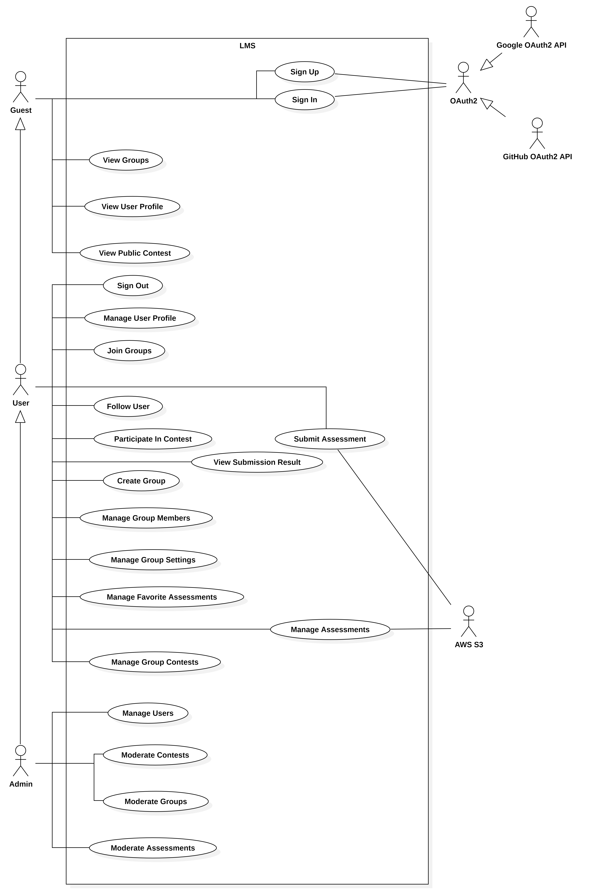
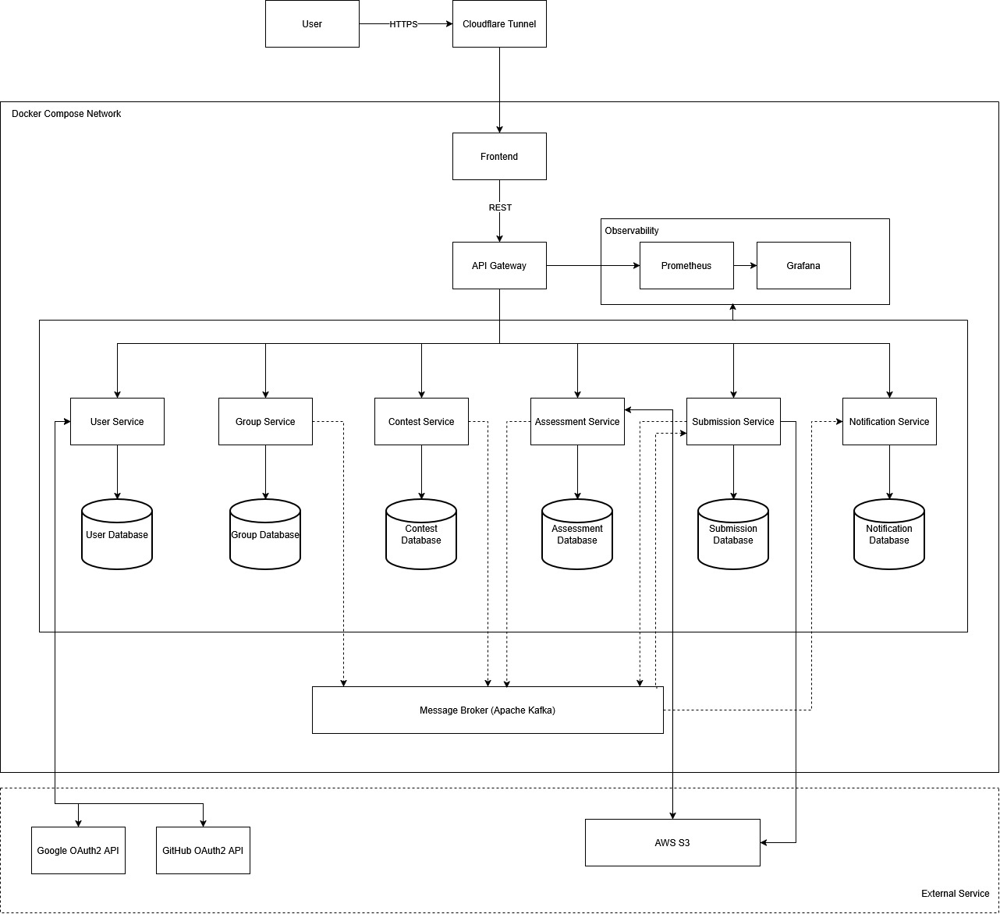
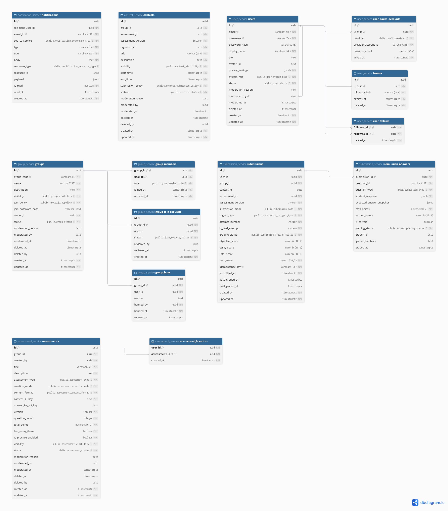

# I. SYSTEM SPECIFICATION

Learning Management System (LMS) – Assessment and Grading Module

## 1. System overview

The LMS Assessment and Grading Module is a web-based application designed to support learning group organization, complete examination set preparation, scheduled contest administration, submission recording, and answer evaluation.

## 1.1 Scope

- **Authentication**: Supports standard credentials alongside Google and GitHub OAuth2.
- **Groups**: Supports lookup via unique Group Code or board view, membership management, direct joining for public groups, and administrator approval or shared passwords for private groups.
- **Exam Packages**: Each Assessment represents a complete examination set supporting single-choice, multiple-choice, fill-in-the-blank, and rich-text essay items.
- **Authoring & Access**: Assessments can be created directly on the platform or imported from PDF documents, with answer keys for multiple-choice items mapped manually.
- **Contest Rules**: Organizers define fixed start/end timestamps, visibility (group-scoped), and submission policies (e.g. single attempt, or multiple attempts where only the final submission is evaluated).
- **Submission & Grading Pipeline**: Once submitted, the answers enter an asynchronous Kafka processing flow: objective items are auto-graded immediately, whereas rich-text essays remain PENDING until manually evaluated by the Accessment Owner to publish the combined result.
- **Notifications**: Processes events from other microservices and manages user notifications.
- **System Monitoring**: Encompasses microservice operational health tracking and performance visualization using Prometheus and Grafana.

## 2. Use Case

### 2.1 Roles

| ID | Role | Scope | Description |
| --- | --- | --- | --- |
| R01 | Guest | System-wide | Unauthenticated visitor who can only view available groups, contents and user profiles. |
| R02 | Authenticated User | System-wide | Registered user who can create groups, join public groups, request to join private groups, and participate in public contests. |
| R03 | System Admin | System-wide | Platform administrator who can manage system-level configurations, monitor microservices, and handles user account moderation. |
| R04 | Group Member | Group-scoped | Approved member of a specific group who can view group resources and participate in private/group contests. |
| R05 | Group Moderator | Group-scoped | Designated manager of a group who can manage group memberships, create assessments, configure contest rules, and grade essay submissions. |
| R06 | Group Owner | Group-scoped | Creator and owner of the group who inherits all permissions of a Group Moderator with exclusive authority to assign/revoke moderators, update group settings, transfer ownership, or delete the group. |

*Table 1. Roles of the LMS.*

### 2.2 Actors líst

| ID | Actor | Type | Description |
| --- | --- | --- | --- |
| A01 | Guest | Primary | Unauthenticated user, is able to access public activity. |
| A02 | User | Primary | Authenticated user who can join groups, practice exams, take part in contests, and submit answers. |
| A03 | Admin | Primary | Platform administrator who manages all user accounts, roles, groups and assessments. |
| A04 | OAuth2 | Abstract Supporting | An interface for external authentication service |
| A05 | Google OAuth2 API | Supporting | External authentication service used when Google sign-in is selected. |
| A06 | GitHub OAuth2 API | Supporting | External authentication service used when GitHub sign-in is selected. |
| A07 | AWS S3 | Supporting | External storage service for upload files. |

*Table 2. Actors of the LMS assessment and grading system.*

### 2.3 Use Cases list

| ID | Use Case Name | Primary Actor | Role | Description |
| --- | --- | --- | --- | --- |
| UC01 | Sign In | Guest | R01 | Authenticates unauthenticated user. |
| UC02 | Sign Up | Guest | R01 | Creates a new user account. |
| UC03 | View Groups | Guest | R01 | Views list of available groups. |
| UC04 | View User Profile | Guest | R01 | Views a user profile. |
| UC05 | View Public Contest | Guest | R01 | Views public contests. |
| UC06 | Sign Out | User | R02 | Removes a user session |
| UC07 | Manage User Profile | User | R02 | Views, changes or shares user’s profile. |
| UC08 | Join Groups | User | R02 | Joins public or private groups. |
| UC09 | Participate in Contest | User | R02, R04 | Participates in public or private contests. |
| UC10 | Submit Assessment | User | R02, R04 | Submits completed assessment responses manually or automatically upon timeout. |
| UC11 | View Submission Result | User | R02, R04 | View user’s submission results. |
| UC12 | Follow User | User | R02 | Follows a user. |
| UC13 | Manage Favorite Assessments | User | R02 | Views, marks or unmarks an assessment as a favorite. |
| UC14 | Create Group | User | R02 | Creates a group. |
| UC15 | Manage Group Members | User | R05, R06 | Approves, removes, or bans members. |
| UC16 | Manage Assessments | User | R05, R06 | Creates, updates, or deletes practice and contest assessments. |
| UC17 | Manage Group Contests | User | R05, R06 | Creates and configures contests within a group. |
| UC18 | Manage Group Settings | User | R06 | Updates group settings, assigns or revokes moderators, transfers ownership, or deletes the group. |
| UC19 | Manage Users | Admin | R03 | Views, suspends, bans, or manages user accounts across the system. |
| UC20 | Moderate Groups | Admin | R03 | Monitors, moderates, or deletes any group violating system policies. |
| UC21 | Moderate Contests | Admin | R03 | Moderates system-wide contests. |
| UC22 | Moderate Assessments | Admin | R03 | Moderates system-wide assessments. |

*Table 3. Use cases of the LMS assessment and grading system.*

### 2.4 Use Case Diagram

### 2.5 Use case Specification

#### 2.5.1 UC01 - Sign In

- **Use Case Name:** Sign In
- **Actor(s):** Guest, Google OAuth2 API, Github OAuth2 API
- **Description:** As a guest, I want to authenticate, so that I become an authenticated User
- **Pre-condition(s):** Guest has not yet authenticated.
- **Post-condition(s):**
  - User session created.
  - User role changed from Guest to User or Admin.
- **Basic Flow:**
  1. Guest opens the platform.
  2. Guest clicks the **Sign In** Button.
  3. System displays the sign-in form (email/username and password) with Google and Github options.
  4. Guest enter user’s credentials and clicks **Sign In**.
  5. System validates the credentials.
  6. System creates a user session and redirects Guest to the home page.
- **Alternative Flow:**
  - A1: Invalid credentials (step 5): System shows an error and returns to step 3.
  - A2: Sign in with Google (step 3): System redirects to Google OAuth2, receives the user’s profile, creates or finds the account, then continues at step 6.
  - A3: Sign in with Github (step 3): System redirects to Github OAuth2, receives the user’s profile, craetes or finds the account, then continues at step 6.
  - A4: Account is locked (step 5): System shows a locked-account message and denied access.
  - E1: OAuth2 provider fails or Guest denies permission: System shows an error and return to step 3.

#### 2.5.2 UC02 - Sign Up

- **Use Case Name:** Sign Up
- **Actor(s):** Guest, Google OAuth2 API, Github OAuth2 API
- **Description:** As a guest, I want to create a new user account, so that I become an authenticated User.
- **Pre-condition(s):** Guest has not yet authenticated.
- **Post-condition(s):**
  - New user account is created.
  - User session is created and role changed from Guest to User.
- **Basic Flow:**
  1. Guest opens the platform.
  2. Guest clicks the **Sign Up** button.
  3. System displays the registration form (email, username, and password) with Google and Github options.
  4. Guest enters registration details and clicks **Sign Up**.
  5. System validates the input details and creates a new user account.
  6. System creates a user session and redirects Guest to the home page.
- **Alternative Flow:**
  - A1: Sign up with Google (step 3): System redirects to Google OAuth2, receives the user's profile, creates the account if it does not exist, then continues at step 6.
  - A2: Sign up with Github (step 3): System redirects to Github OAuth2, receives the user's profile, creates the account if it does not exist, then continues at step 6.
  - A3: Email or username already exists (step 5): System shows a conflict error message and returns to step 3.
  - A4: Invalid input format or weak password (step 5): System displays validation errors and returns to step 3.
  - E1: OAuth2 provider fails or Guest denies permission: System shows an error and returns to step 3.

#### 2.5.3 UC03 - View Groups

- **Use Case Name:** View Groups
- **Actor(s):** Guest
- **Description:** As a guest, I want to view the list of available groups or look up a group by Group Code, so that I can discover groups on the platform.
- **Pre-condition(s):** Guest is on the platform.
- **Post-condition(s):**
  - List of available groups or matching group overview is displayed.
- **Basic Flow:**
  1. Guest opens the platform and navigates to the **Groups** board.
  2. System displays the list of available groups (name, description, Group Code, and public or private access type).
  3. Guest browses the board or selects a group to view its public overview.
  4. System displays the group's public overview and prompts Guest to sign in to join.
- **Alternative Flow:**
  - A1: Search by Group Code (step 2): Guest enters a unique Group Code in the search bar and clicks **Search**; System locates and displays the matching group.
  - A2: No matching groups found (step 2): System shows a not-found or empty-list message.
  - A3: Selected group is private (step 3): System displays only the group's basic overview and states that joining requires approval or a shared password after signing in.
  - E1: System fails to load groups (step 2): System displays an error message and offers to retry.

#### 2.5.4 UC04 - View User Profile

- **Use Case Name:** View User Profile
- **Actor(s):** Guest
- **Description:** As a guest, I want to view a user's profile, so that I can see their public information on the platform.
- **Pre-condition(s):** Target user account exists.
- **Post-condition(s):**
  - Public profile of the target user is displayed.
- **Basic Flow:**
  1. Guest selects a user's name or opens a user profile link.
  2. System retrieves the user's public profile data.
  3. System displays the public profile details.
- **Alternative Flow:**
  - A1: User profile has restricted fields (step 2): System hides private fields and displays only publicly available profile information.
  - A2: User does not exist (step 2): System shows a user-not-found message.
  - A3: User is banned (step 2): System shows user’s profile with a RESTRICTED banner
  - E1: System fails to retrieve profile (step 2): System shows an error message.

#### 2.5.5 UC05 - View Public Contest

- **Use Case Name:** View Public Contest
- **Actor(s):** Guest
- **Description:** As a guest, I want to view public contests, so that I can inspect upcoming and ongoing contest schedules and rules.
- **Pre-condition(s):** Guest is on the platform.
- **Post-condition(s):**
  - List and details of public contests are displayed.
- **Basic Flow:**
  1. Guest navigates to the **Contests** page.
  2. System retrieves and displays available public contests (title, start and end timestamps, status, and submission policy).
  3. Guest selects a public contest.
  4. System displays the contest schedule and rules.
- **Alternative Flow:**
  - A1: Filter or search public contests (step 2): Guest filters contests by status or keyword; System updates the displayed list.
  - A2: No public contests available (step 2): System displays an empty-state notice.
  - A3: Guest attempts to enter a contest (step 4): System prompts Guest to sign in before participating.
  - E1: System fails to load contests (step 2): System shows an error message and allows retrying.

#### 2.5.6 UC06 - Sign Out

- **Use Case Name:** Sign Out
- **Actor(s):** User
- **Description:** As an authenticated user, I want to sign out of the platform, so that my user session is closed securely.
- **Pre-condition(s):** User has an active authenticated session.
- **Post-condition(s):**
  - User session is removed.
  - Actor reverts from User (or Admin) to Guest.
- **Basic Flow:**
  1. User opens the account menu.
  2. User clicks the **Sign Out** button.
  3. System terminates the active user session.
  4. System clears authentication state and redirects User to the home or sign-in page.
- **Alternative Flow:**
  - A1: Session has already expired (step 3): System clears local session state and redirects to the sign-in page.
  - E1: Session termination request fails (step 3): System displays a warning, clears local session state, and completes sign-out.

#### 2.5.7 UC07 - Manage User Profile

- **Use Case Name:** Manage User Profile
- **Actor(s):** User
- **Description:** As an authenticated user, I want to view, update, or share my profile, so that my personal information remains accurate and accessible.
- **Pre-condition(s):** User is authenticated (R02).
- **Post-condition(s):**
  - Updated profile details are saved, or profile link is shared.
- **Basic Flow:**
  1. User navigates to the **Profile** page.
  2. System displays User's profile details.
  3. User clicks **Edit Profile**, updates desired fields (display name, bio, or avatar), and clicks **Save**.
  4. System validates the updated details and saves the changes.
  5. System displays a confirmation message with the updated profile.
- **Alternative Flow:**
  - A1: Share profile (step 2): User clicks **Share Profile**; System provides or copies the shareable profile link.
  - A2: Change password (step 3): For credential-based accounts, User enters current and new password; System verifies the current password and saves the updated credentials.
  - A3: Invalid profile input (step 4): System displays validation errors and returns to step 3.
  - E1: System fails to save profile updates (step 4): System shows an error message and preserves unsaved input.

#### 2.5.8 UC08 - Join Groups

- **Use Case Name:** Join Groups
- **Actor(s):** User
- **Description:** As an authenticated user, I want to join public or private groups, so that I can participate in group activities and assessments.
- **Pre-condition(s):**
  - User is authenticated (R02).
  - Target group exists and User is not currently a member of that group.
- **Post-condition(s):**
  - User becomes a Group Member (R04) of the group, or a join request is recorded as PENDING for approval.
- **Basic Flow:**
  1. User locates a group via the groups board or by entering a Group Code.
  2. System displays the group details and whether it is a public or private group.
  3. User clicks **Join Group** on a public group.
  4. System verifies membership eligibility and adds User to the group as a Group Member (R04).
  5. System redirects User to the group workspace.
- **Alternative Flow:**
  - A1: Join private group with shared password (step 3): System prompts for the group password; User enters the password, System verifies it, and continues at step 4.
  - A2: Request to join private group requiring approval (step 3): User clicks **Request to Join**; System creates a PENDING join request and notifies the group administrators.
  - A3: Incorrect group password (A1): System displays an invalid-password error and denies access.
  - A4: User is already a member or has a pending request (step 4): System displays a notice with the current membership or request status.
  - A5: User is banned from the group (step 4): System denies access with a message stating User cannot join this group.
  - E1: Group not found or request fails (step 2 or 4): System displays an error message.

#### 2.5.9 UC09 - Participate in Contest

- **Use Case Name:** Participate in Contest
- **Actor(s):** User
- **Description:** As an authenticated user or group member, I want to participate in public or private contests, so that I can complete the exam within the scheduled window.
- **Pre-condition(s):**
  - User is authenticated (R02).
  - For private/group contests, User holds the Group Member role (R04) in the owning group.
- **Post-condition(s):**
  - Contest assessment questions are loaded for User without exposing answer keys.
  - In-progress answers are continuously cached in browser localStorage.
- **Basic Flow:**
  1. User selects an active contest from the public contests board or group workspace and clicks **Participate**.
  2. System verifies access permissions, checks that the current time is within the contest's fixed start and end timestamps, and checks the submission policy.
  3. System loads the assessment content (excluding answer keys) and starts the countdown timer.
  4. System restores any previously saved draft answers from browser localStorage.
  5. User completes single-choice, multiple-choice, fill-in-the-blank, or rich-text essay items while browser localStorage continuously caches answers.
- **Alternative Flow:**
  - A1: Contest has not started yet (step 2): System displays the scheduled start countdown and denies exam access.
  - A2: Contest has ended or been cancelled (step 2): System blocks contest participation; if open practice is allowed for past exams, User may practice outside the contest.
  - A3: User is not a member of the private group (step 2): System denies access and informs User that group membership is required.
  - A4: Single-submission policy already used (step 2): System informs User that the allowed attempt has already been submitted.
  - A5: Page reload or temporary network drop (step 5): Browser restores in-progress answers seamlessly from localStorage without data loss.
  - E1: System fails to load exam content (step 3): System displays an error message and offers to retry.

#### 2.5.10 UC10 - Submit Assessment

- **Use Case Name:** Submit Assessment
- **Actor(s):** User, AWS S3
- **Description:** As a user or group member, I want to submit my completed assessment manually or automatically upon timeout, so that my answers are processed and graded.
- **Pre-condition(s):** User is authenticated (R02 or R04) and actively taking a contest or practice assessment.
- **Post-condition(s):**
  - Submission payload is accepted into the asynchronous Kafka processing queue.
  - Objective questions (single-choice, multiple-choice, fill-in-the-blank) are auto-graded; essay sections remain PENDING until manual evaluation.
  - Cached draft in browser localStorage is cleared upon successful submission.
- **Basic Flow:**
  1. User reviews answers and clicks **Submit**.
  2. System prompts for confirmation.
  3. User clicks **Confirm Submit**.
  4. System validates the contest time window and submission policy.
  5. System pushes the submission payload to Kafka for asynchronous processing, clears the localStorage draft, and notifies User that the submission was received.
  6. System processes the queued submission, retrieves the mapped answer key (and static PDF reference if stored on AWS S3), auto-grades objective items, and stores the grading record.
- **Alternative Flow:**
  - A1: Automatic submission on timeout (step 1): Contest timer reaches the end timestamp; System automatically submits the current answers from the interface/localStorage and continues at step 4.
  - A2: Hybrid or essay assessment (step 6): System immediately calculates and returns the score for automated sections while locking the essay section under PENDING status until manual evaluation unlocks the final combined score.
  - A3: Multiple-submission policy (step 4): System accepts resubmission within the active window and marks only the final attempt for evaluation.
  - A4: Single-submission policy duplicate attempt (step 4): System rejects the duplicate submission.
  - A5: Open practice submission (step 4): System accepts and grades the practice attempt without contest window restrictions.
  - E1: Submission sent after window closed (step 4): System rejects the late submission with a timeout error.
  - E2: Submission queue or network failure (step 5): Client preserves in-progress answers in localStorage and prompts User to retry.

#### 2.5.11 UC11 - View Submission Result

- **Use Case Name:** View Submission Result
- **Actor(s):** User
- **Description:** As a user or group member, I want to view my submission results, so that I can review my scores and grading feedback.
- **Pre-condition(s):**
  - User is authenticated (R02 or R04).
  - User has made at least one submission.
- **Post-condition(s):**
  - Grading results and status of User's submission are displayed.
- **Basic Flow:**
  1. User navigates to **Results** or opens a completed contest or assessment.
  2. System verifies that User owns the requested submission.
  3. System retrieves the submission details, auto-graded score, essay evaluation status, and total score.
  4. System displays the detailed grading result.
- **Alternative Flow:**
  - A1: Essay evaluation is PENDING (step 3): System displays the score for automated sections while keeping the essay section and final combined score locked as PENDING.
  - A2: Submission is still being processed in the queue (step 3): System informs User that grading is in progress and allows refreshing.
  - A3: Multiple attempts submitted (step 1): System lists User's attempts and indicates that only the final attempt is evaluated.
  - A4: Attempt to access another user's submission (step 2): System denies access.
  - E1: Result not found or retrieval fails (step 3): System displays an error message.

#### 2.5.12 UC12 - Follow User

- **Use Case Name:** Follow User
- **Actor(s):** User
- **Description:** As an authenticated user, I want to follow another user, so that I can stay connected with instructors and peers on the platform.
- **Pre-condition(s):**
  - User is authenticated (R02).
  - Target user account exists.
- **Post-condition(s):**
  - Follow relationship between User and target user is saved or removed.
- **Basic Flow:**
  1. User opens another user's profile.
  2. User clicks the **Follow** button.
  3. System validates that the target user exists and differs from the current user.
  4. System records the follow relationship and updates the button state to **Following**.
- **Alternative Flow:**
  - A1: Unfollow a user (step 2): User clicks **Following**; System removes the follow relationship and reverts the button to **Follow**.
  - A2: User attempts to follow self (step 3): System rejects the action.
  - A3: Target user account is unavailable (step 3): System displays an error message.
  - E1: System fails to update follow state (step 4): System displays an error and keeps the previous state.

#### 2.5.13 UC13 - Manage Favorite Assessments

- **Use Case Name:** Manage Favorite Assessments
- **Actor(s):** User
- **Description:** As an authenticated user, I want to view, mark, or unmark assessments as favorites, so that I can quickly access preferred exams.
- **Pre-condition(s):**
  - User is authenticated (R02).
  - User has permission to view the target assessment.
- **Post-condition(s):**
  - User's favorite assessments list is updated.
- **Basic Flow:**
  1. User views an accessible assessment.
  2. User clicks the **Favorite** button on the assessment.
  3. System verifies assessment availability and adds it to User's favorite assessments list.
  4. System updates the UI to show the assessment is marked as a favorite.
- **Alternative Flow:**
  - A1: View favorite assessments list (step 1): User opens **Favorites**; System displays all assessments currently marked as favorites.
  - A2: Unmark an assessment as favorite (step 2): User clicks **Unfavorite** on a marked assessment; System removes it from the favorites list.
  - A3: Assessment is no longer available or access was revoked (step 3): System shows an error notice.
  - E1: System fails to update favorite list (step 3): System shows an error message and preserves the prior state.

#### 2.5.14 UC14 - Create Group

- **Use Case Name:** Create Group
- **Actor(s):** User
- **Description:** As an authenticated user, I want to create a new learning group, so that I can organize members, assessments, and contests.
- **Pre-condition(s):** User is authenticated (R02).
- **Post-condition(s):**
  - New group is created with a unique Group Code.
  - Creator is assigned the Group Owner role (R06) for the new group.
- **Basic Flow:**
  1. User navigates to the **Groups** page and clicks **Create Group**.
  2. System displays the group creation form (name, description, and public or private access configuration).
  3. User enters the group details, selects public access, and clicks **Create**.
  4. System validates the details, generates a unique Group Code, creates the group, and assigns User as Group Owner (R06).
  5. System redirects User to the newly created group workspace.
- **Alternative Flow:**
  - A1: Create private group with administrator approval (step 3): User selects private access with manual approval before clicking **Create**.
  - A2: Create private group with shared password (step 3): User selects private access, enters a shared group password, and clicks **Create**.
  - A3: Invalid input or missing required fields (step 4): System displays validation errors and returns to step 2.
  - E1: Group creation fails (step 4): System rolls back changes and displays an error message.

#### 2.5.15 UC15 - Manage Group Members

- **Use Case Name:** Manage Group Members
- **Actor(s):** User
- **Description:** As a Group Moderator or Group Owner, I want to approve, remove, or ban members, so that group membership remains controlled and orderly.
- **Pre-condition(s):**
  - User is authenticated.
  - User holds the Group Moderator (R05) or Group Owner (R06) role in the target group.
- **Post-condition(s):**
  - Join requests are approved or rejected, or member statuses are updated.
  - Notifications are issued to affected users.
- **Basic Flow:**
  1. User opens the group workspace and navigates to **Manage Members**.
  2. System verifies Group Moderator or Group Owner permission and displays current members and pending join requests.
  3. User selects a pending join request and clicks **Approve**.
  4. System approves the request, grants the applicant Group Member (R04) role, and sends a notification to the applicant.
  5. System refreshes the member and pending request lists.
- **Alternative Flow:**
  - A1: Reject a join request (step 3): User clicks **Reject**; System marks the request rejected and sends a notification.
  - A2: Remove a group member (step 3): User selects an existing member and clicks **Remove**; System revokes the member's access to the group.
  - A3: Ban a group member (step 3): User selects a member and clicks **Ban**; System removes the member and prevents future re-entry.
  - A4: Attempt to remove or ban the Group Owner (step 4): System denies the action.
  - E1: Request already processed or member not found (step 4): System shows an error message and refreshes the list.

#### 2.5.16 UC16 - Manage Assessments

- **Use Case Name:** Manage Assessments
- **Actor(s):** User, AWS S3
- **Description:** As a Group Moderator or Group Owner, I want to create, update, or delete practice and contest assessments, so that group members can take exams and practice.
- **Pre-condition(s):**
  - User is authenticated.
  - User holds the Group Moderator (R05) or Group Owner (R06) role in the target group.
- **Post-condition(s):**
  - Assessment metadata and questions/PDF content are created, updated, or deleted.
  - Uploaded files and generated assessment data are stored in AWS S3.
- **Basic Flow:**
  1. User opens the group workspace, selects **Assessments**, and clicks **Create Assessment**.
  2. System displays the assessment authoring interface (title, type, practice availability, and creation mode: direct platform authoring or PDF upload).
  3. User authors a complete examination set directly on the platform (single-choice, multiple-choice, fill-in-the-blank, or essay questions with answer keys) and clicks **Save**.
  4. System validates the assessment content, stores the exam package files in AWS S3, and saves metadata.
  5. System displays the created assessment in the group's assessments list.
- **Alternative Flow:**
  - A1: Create assessment from static PDF (step 3): User uploads a PDF exam file to AWS S3 and manually maps the multiple-choice answer key on the platform before saving.
  - A2: Update an existing assessment (step 1): User selects an assessment, edits metadata, questions, PDF file, or mapped answer key, and saves changes.
  - A3: Delete an assessment (step 1): User selects an assessment, clicks **Delete**, and confirms; System removes or archives the assessment.
  - A4: Validation failure or invalid file format (step 4): System displays validation errors and returns to step 2.
  - E1: AWS S3 upload or storage failure (step 4): System aborts the operation and displays an error message.

#### 2.5.17 UC17 - Manage Group Contests

- **Use Case Name:** Manage Group Contests
- **Actor(s):** User
- **Description:** As a Group Moderator or Group Owner, I want to create, configure, and manage contests and essay evaluations within a group, so that scheduled assessments run properly.
- **Pre-condition(s):**
  - User is authenticated.
  - User holds the Group Moderator (R05) or Group Owner (R06) role in the target group.
- **Post-condition(s):**
  - Contest configuration is created, updated, or cancelled, and group members are notified when applicable.
- **Basic Flow:**
  1. User opens the group workspace, selects **Contests**, and clicks **Create Contest**.
  2. System displays the contest form (title, description, assessment selection, start and end timestamps, and single or multiple submission policy).
  3. User configures the contest details and clicks **Publish Contest**.
  4. System validates Group Moderator/Owner permission, verifies the selected assessment and time window, saves the contest, and triggers notifications to group members.
  5. System displays the scheduled contest in the group contests list.
- **Alternative Flow:**
  - A1: Edit contest details (step 1): User selects an upcoming contest, modifies allowed settings or schedule, and saves.
  - A2: Cancel a contest (step 1): User clicks **Cancel Contest** on a contest that has not ended; System marks it cancelled and stops accepting submissions.
  - A3: Manually evaluate PENDING essay submissions (step 1): User opens **Submissions**, reviews a participant's essay response, enters the essay score, and clicks **Confirm Grade**; System unlocks the final combined score and sends a grading notification.
  - A4: Invalid time window or missing assessment (step 4): System displays validation errors and returns to step 2.
  - A5: Attempt to modify an ended contest (A1): System denies the edit.
  - E1: System fails to save contest or evaluation (step 4 or A3): System displays an error message.

#### 2.5.18 UC18 - Manage Group Settings

- **Use Case Name:** Manage Group Settings
- **Actor(s):** User
- **Description:** As a Group Owner, I want to update group settings, manage moderators, transfer ownership, or delete the group, so that I maintain complete administrative control over my group.
- **Pre-condition(s):**
  - User is authenticated.
  - User holds the Group Owner role (R06) for the target group.
- **Post-condition(s):**
  - Group settings, moderator roles, ownership assignment, or group deletion state is updated.
- **Basic Flow:**
  1. User opens the group workspace and navigates to **Group Settings**.
  2. System verifies Group Owner (R06) permission and displays current group settings and moderator assignments.
  3. User modifies group settings (name, description, public/private access mode, or shared group password) and clicks **Save Settings**.
  4. System validates and saves the updated group settings.
  5. System displays a confirmation message.
- **Alternative Flow:**
  - A1: Assign or revoke Group Moderator (step 3): Group Owner promotes a Group Member to Group Moderator (R05) or revokes an existing moderator back to Group Member (R04).
  - A2: Transfer group ownership (step 3): Group Owner selects an active Group Member, confirms ownership transfer, and System reassigns the Group Owner role (R06) to that member.
  - A3: Delete group (step 3): Group Owner clicks **Delete Group** and confirms; System removes the group and its memberships.
  - A4: User does not hold Group Owner role (step 2): System denies access to exclusive Group Owner settings.
  - E1: Target member not found or save fails (step 4): System cancels the update and shows an error message.

#### 2.5.19 UC19 - Manage Users

- **Use Case Name:** Manage Users
- **Actor(s):** Admin
- **Description:** As a System Admin, I want to view, suspend, ban, or manage user accounts across the system, so that platform security and user compliance are enforced.
- **Pre-condition(s):** Actor is authenticated with the System Admin role (R03).
- **Post-condition(s):**
  - Target user account status or role is updated across the platform.
- **Basic Flow:**
  1. Admin navigates to the **User Management** console.
  2. System verifies System Admin (R03) permission and displays the list of platform user accounts.
  3. Admin searches for and selects a target user account.
  4. Admin selects **Suspend** (or updates account state) and provides a reason.
  5. System updates the user account status, invalidates active sessions for suspended/banned users, and displays the updated user list.
- **Alternative Flow:**
  - A1: Ban or reactivate a user account (step 4): Admin clicks **Ban** to permanently restrict an account or **Reactivate** to restore a suspended account.
  - A2: Update system role (step 4): Admin assigns or revokes the Admin role for a user account.
  - A3: Admin attempts to suspend, ban, or demote own account (step 5): System blocks the action and displays a warning.
  - E1: Target user not found or operation fails (step 3 or 5): System displays an error message.

#### 2.5.20 UC20 - Moderate Groups

- **Use Case Name:** Moderate Groups
- **Actor(s):** Admin
- **Description:** As a System Admin, I want to monitor, moderate, or delete any group violating system policies, so that platform groups remain compliant.
- **Pre-condition(s):** Actor is authenticated with the System Admin role (R03).
- **Post-condition(s):**
  - Target group is moderated, suspended, or deleted, and the Group Owner is notified.
- **Basic Flow:**
  1. Admin navigates to the **Group Moderation** console.
  2. System verifies System Admin (R03) permission and displays all groups across the platform.
  3. Admin inspects a flagged or selected group.
  4. Admin clicks **Delete Group** (or **Suspend Group**), enters a moderation reason, and confirms.
  5. System updates or removes the group, notifies the Group Owner, and refreshes the console.
- **Alternative Flow:**
  - A1: Restore a suspended group (step 4): Admin selects a suspended group and clicks **Restore** to re-enable normal access.
  - A2: No groups match search/filter criteria (step 2): System shows an empty-state message.
  - E1: Group not found or moderation action fails (step 5): System displays an error message.

#### 2.5.21 UC21 - Moderate Contests

- **Use Case Name:** Moderate Contests
- **Actor(s):** Admin
- **Description:** As a System Admin, I want to monitor and moderate system-wide contests, so that invalid or policy-violating contests are handled promptly.
- **Pre-condition(s):** Actor is authenticated with the System Admin role (R03).
- **Post-condition(s):**
  - Target contest is unpublished, cancelled, or removed, and the organizer is notified.
- **Basic Flow:**
  1. Admin navigates to the **Contest Moderation** console.
  2. System verifies System Admin (R03) permission and displays contests across the platform.
  3. Admin selects a contest to review its details and rules.
  4. Admin clicks **Cancel Contest** (or **Remove Contest**), enters a moderation reason, and confirms.
  5. System updates or removes the contest, notifies the contest organizer, and refreshes the contest list.
- **Alternative Flow:**
  - A1: Unpublish an active contest for review (step 4): Admin hides the contest from participants pending organizer correction.
  - A2: No contests match filter criteria (step 2): System displays an empty-state result.
  - E1: Contest not found or moderation action fails (step 5): System displays an error message.

#### 2.5.22 UC22 - Moderate Assessments

- **Use Case Name:** Moderate Assessments
- **Actor(s):** Admin
- **Description:** As a System Admin, I want to monitor and moderate system-wide assessments, so that inappropriate or compromised assessments are removed or restricted.
- **Pre-condition(s):** Actor is authenticated with the System Admin role (R03).
- **Post-condition(s):**
  - Target assessment is hidden or removed, and the assessment owner is notified.
- **Basic Flow:**
  1. Admin navigates to the **Assessment Moderation** console.
  2. System verifies System Admin (R03) permission and displays assessments across the platform.
  3. Admin selects an assessment to review its metadata and content.
  4. Admin clicks **Remove Assessment** (or **Hide Assessment**), enters a moderation reason, and confirms.
  5. System updates or removes the assessment, notifies the assessment owner, and refreshes the assessment list.
- **Alternative Flow:**
  - A1: Restore a hidden assessment (step 4): Admin restores access after review.
  - A2: No assessments match filter criteria (step 2): System displays an empty-state message.
  - E1: Assessment not found or moderation action fails (step 5): System displays an error message.

## 3. Services

### 3.1 Domain Boundary

To decompose the system into separate services, a **Domain Table** is defined to group the use cases above by domain boundary and determine which service owns each use case.

| Domain | Use cases |
| :-- | :-- |
| Authentication | `UC01`, `UC02`, `UC06` |
| User | `UC04`, `UC07`, `UC12`, `UC19` |
| Group | `UC03`, `UC08`, `UC14`, `UC15`, `UC18`, `UC20` |
| Contest | `UC05`, `UC09`, `UC17`, `UC21` |
| Assessment | `UC13`, `UC16`, `UC22` |
| Submission | `UC10`, `UC11`, `UC17` |
| Notification | *(Event-driven — triggered by `UC08`, `UC10`, `UC15`, `UC17`, `UC20`, `UC21`, `UC22`)* |

### 3.2 Services List

Based on the **Domain Table** defined above, the system is decomposed into 6 independent services:

| Service | Domain |
| :-- | :-- |
| User Service | `Authentication`, `User` |
| Group Service | `Group` |
| Contest Service | `Contest` |
| Assessment Service | `Assessment` |
| Submission Service | `Submission` |
| Notification Service | `Notification` |

### 3.3 Microservice Architecture

## 4. Database Design

## 5. Tech Stack

|  | Stack |
| :-- | :-- |
| Frontend | React, Vite, Typescript, Ky |
| Backend & API Gateway | Go + Gin for Submission Service, Typescript + Hono for others |
| Service Communication | Got, net/http for Go |
| External Authentication | Google OAuth2 API, GitHub OAuth2 API |
| Database | PostgreSQL |
| ORM | MikroORM, GORM  |
| Object Storage | AWS S3 |
| Message Broker | Apache Kafka |
| Observability | Prometheus, Grafana |
| Containerization | Docker, Docker Compose |
| Tunnel | Cloudflare Tunnel |
| API Docs | OpenAPI + Swagger UI |
| Workspace | Nx |
